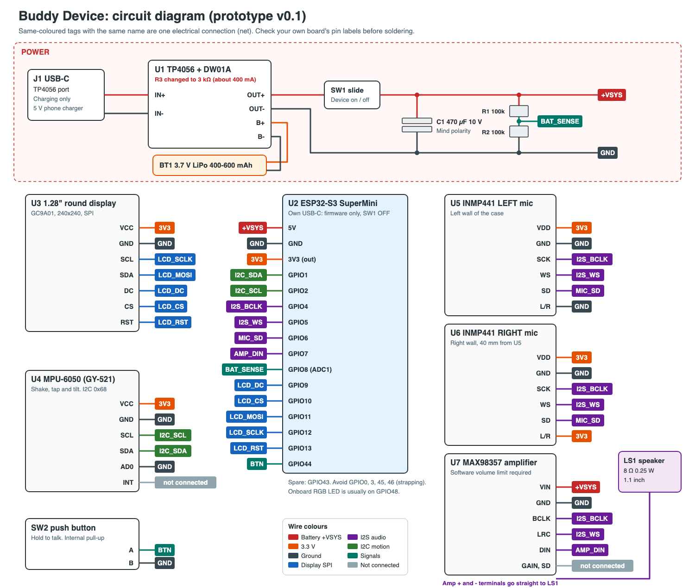
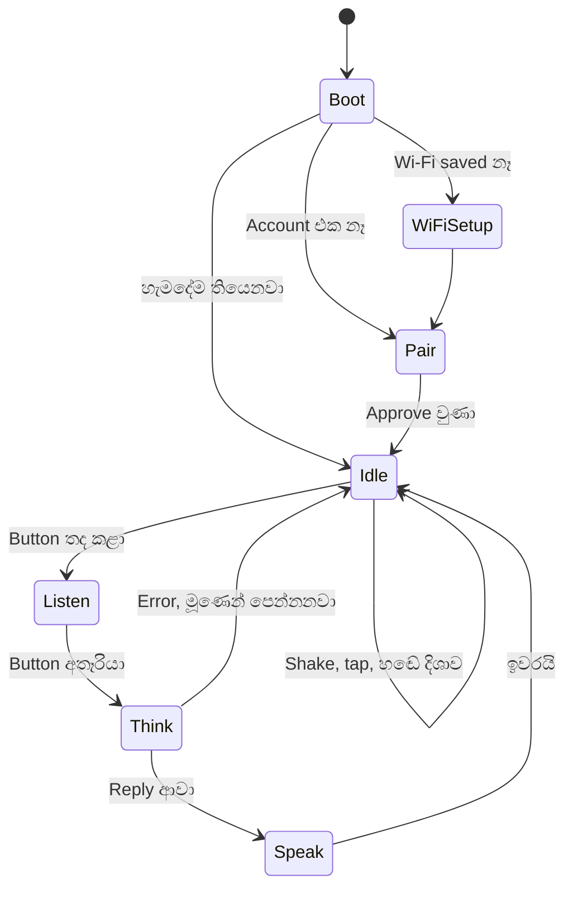
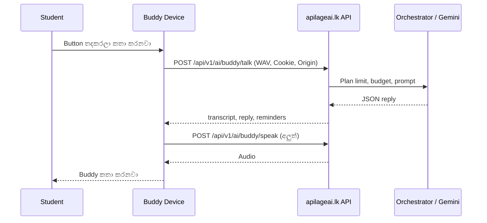
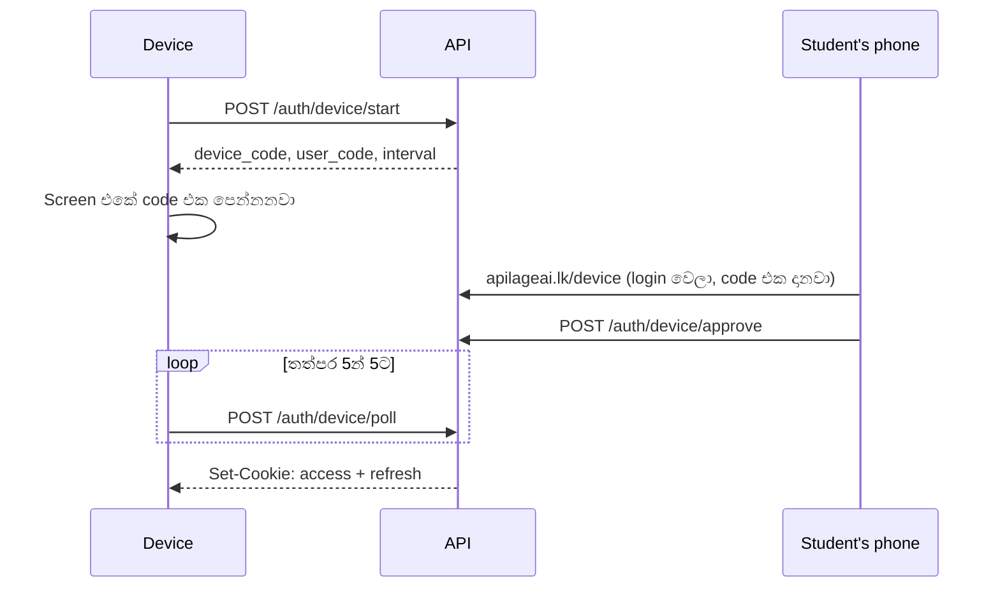

# Buddy Device: Project Documentation

**Version:** Prototype v0.1 (design). **තත්ත්වය:** මේක design document එකක්. Hardware එකවත්, firmware එකවත්, මෙහි කියන backend වෙනස්කම්වත් තවම හදලා හෝ test කරලා නෑ.

## 1. Project Overview

Buddy Device කියන්නේ ApilageAI Buddy ට physical body එකක්. ඒක පොඩි, battery එකෙන් වැඩ කරන device එකක්: screen එකේ Buddyගේ මූණ පේනවා, student කතා කළාම අහනවා, ApilageAI account එක හරහා AI එකෙන් උත්තර අරන් හඬින් කියනවා. Internet නැති වෙලාවටත් Buddy මූණ, shake effects, timer වගේ දේවල් වැඩ කරනවා.

| | |
|---|---|
| ඉලක්කය | Sri Lankan students ලාට study companion device එකක් |
| Chip | ESP32-S3 (Wi-Fi 2.4 GHz, Bluetooth LE) |
| ප්‍රමාණය | ආසන්න වශයෙන් 50 × 50 × 25 mm (ඇස්තමේන්තුවක්, CAD එකෙන් තහවුරු කරන්න) |
| බලය | 3.7 V LiPo, USB-C charging |
| AI | Device එකේ නෙවෙයි, ApilageAI cloud එකේ |
| Parts වියදම | රු. 8,500-13,000 පමණ, case එක එක්ක |

Device එක කරන්නේ හඬ අල්ලලා cloud එකට යවන එකයි, උත්තරය පෙන්නලා කියන එකයි. AI model එක, plan limits සහ budget දැනටමත් තියෙන backend එකේ තියෙනවා.

## 2. Features

| Feature | ක්‍රියාත්මක වෙන විදිය | Internet? | හදන්න ඕනේ දේ |
|---|---|---|---|
| Buddy මූණ සහ styles | Display එකේ animated ඇස්, expressions | නෑ | Firmware |
| හෙල්ලුවම face effects | MPU-6050: shake → කරකැවෙන ඇස්, tap → පුදුම වීම, උඩු යටි කළාම → දඟකාර මූණ | නෑ | Firmware |
| හඬ එන පැත්තට ඇස් | Mic දෙකේ කාල වෙනසෙන් වම / මැද / දකුණ | නෑ | Firmware. නිරවද්‍යතාව test කරලා බලන්න ඕනේ |
| Button එක තදකරගෙන කතා කිරීම | Clip එක cloud එකට, උත්තරය ආපහු | ඔව් | Firmware |
| සිංහල / English උත්තර | දැනට තියෙන `/buddy/talk` | ඔව් | Backend එකේ දැනටමත් තියෙනවා |
| හඬින් කතා කිරීම | අලුත් TTS endpoint එකක්, MAX98357 සහ speaker | ඔව් | Backend සහ firmware |
| Account login | Screen එකේ code එකක්, phone එකෙන් approve | Setup එකට ඔව් | Backend, website page, firmware |
| Reminders | `/buddy/talk` දෙන reminders flash එකේ තියාගෙන නියමිත වෙලාවට කියනවා | හදන්න ඔව්, වැදෙන්න නෑ | Firmware |
| Focus timer | Device එකේම | නෑ | Firmware |
| Clock | Wi-Fi එකෙන් NTP. **RTC එකක් නැති නිසා power off කළාම වෙලාව නැති වෙනවා** | Sync එකට ඔව් | Firmware |
| Battery level | R1/R2 divider එකෙන් GPIO8 | නෑ | Firmware |
| Wi-Fi setup | Device එකේ setup hotspot + web page | නෑ | Firmware |

**මේ version එකේ නැති දේවල්:** Camera, screen explain (desktop Buddy එකේ `need_screen`), "Hey Buddy" wake word, touch screen, RTC.

**Privacy:** ඇස් හැරවීම නිසා mic දෙක අඩු බලයකින් නිතරම ඇහෙනවා. ඒ audio එක device එක ඇතුළේ දිශාව හොයන්න විතරක් පාවිච්චි කරනවා; save කරන්නේවත් යවන්නේවත් නෑ. Cloud එකට යන්නේ button එක තද කරගෙන ඉන්න වෙලාවේ විතරයි, ඒ වෙලාවට මූණෙන් "අහනවා" කියලා පේන්න ඕනේ. Settings වලින් ඇස් හැරවීම off කරන්නත් දෙන්න. මේ ගැන users ලාට පැහැදිලිව කියන්න.

## 3. Hardware (BOM)

මිල shop websites වලින් 2026-10-31 ට බැලුවා. `*` ඇස්තමේන්තු. යන්න කලින් මිල සහ stock එක අහන්න.

| Ref | අයිතමය | Qty | Shop | මිල (රු.) |
|---|---|---|---|---|
| U2 | [ESP32-S3 SuperMini](https://alphatronic.lk/product/esp32-s3-supermini-dev-board-wifi-ble/) | 1 | Alphatronic | 1,550 |
| U3 | [1.28" GC9A01 round display](https://tronic.lk/product/1-28-inch-240x240-round-tft-lcd-display-module-rgb-3-3v) | 1 | Tronic | 1,450 |
| U5, U6 | [INMP441 microphone](https://tronic.lk/product/inmp441-omnidirectional-microphone-module-i2s-interface) | 2 | Tronic | 920 |
| U7 | [MAX98357 amplifier](https://tronic.lk/product/max98357-i2s-3w-class-d-amplifier-breakout-interface-da) | 1 | Tronic | 480 |
| LS1 | [8 Ω 0.25 W 1.1" speaker](https://tronic.lk/product/8-ohm-0-25w-speaker-1-1-inch) | 1 | Tronic | 30 |
| U4 | [MPU-6050 (GY-521)](https://tronic.lk/product/mpu-6050-triple-axis-analog-accelerometer-gyroscope-mod) | 1 | Tronic | 730 |
| U1 | [TP4056 Type-C, protection එක්ක](https://tronic.lk/product/tp4056-5v-1a-type-c-18650-lithium-battery-charging-modu) | 1 | Tronic | 120 |
| BT1 | 3.7 V LiPo, 400-600 mAh, protection එක්ක | 1 | Shops වලින් අහන්න | 700-1,900* |
| SW1, SW2 | Slide switch, push button | 1 බැගින් | Parts shop | 300-600* (වයර් සමඟ) |
| - | සිහින් silicone wire (28-30 AWG), heat shrink, keyring | ටිකක් | Parts shop | ඉහත එකතුවේ |
| R1, R2 | 100 kΩ resistor | 2 | Parts shop | 50* |
| C1 | 470 µF 10 V capacitor | 1 | Parts shop | 50* |
| - | TP4056 R3 සඳහා 3 kΩ SMD resistor | 1 | Parts shop | 50* |
| - | 3D-printed case | attempts 2 | 3D print service | 2,000-5,000* |
| | **මුළු එකතුව** | | | **8,500-13,000 පමණ** |

**Tools:** Soldering iron, solder, multimeter, wire stripper. ඔයා ළඟ නැත්නම් ඒවාට අමතර වියදමක් යනවා.

### ගන්නකොට check කරන්න
- **SuperMini:** Chip එකේ `FH4R2` (4 MB flash, 2 MB PSRAM) තියෙනවද, GPIO 1, 2, 4-13, 44 pins board එකේ label කරලා තියෙනවද. Factories කිහිපයක board වෙනස් වෙන්න පුළුවන්. Back side එකේ `B+`/`B-` pads සහ charger එකක් තියෙනවා නම් මට කියන්න, power design එක වෙනස් කරන්න පුළුවන්.
- **Display:** Pins `VCC GND SCL SDA DC CS RST` ද, `BLK` pin එකක් තියෙනවද.
- **Battery:** + / − පැත්ත multimeter එකෙන් මැනලා බලන්න. ඉදිමුණු හෝ පරණ cells ගන්න එපා.

## 4. Circuit



Editable version එක: [circuit.svg](circuit.svg). එකම නමක් තියෙන tags ඔක්කොම එකම connection එකක්.

### Pin map

| ESP32-S3 pin | Net | යන තැන |
|---|---|---|
| 5V | +VSYS | SW1 හරහා TP4056 OUT+, C1 +, R1, MAX98357 VIN |
| GND | GND | TP4056 OUT−, හැම module එකකම GND, C1 −, R2 |
| 3V3 | 3V3 | Display VCC, MPU-6050 VCC, mic දෙකේ VDD, U6 L/R |
| GPIO1 | I2C_SDA | MPU-6050 SDA |
| GPIO2 | I2C_SCL | MPU-6050 SCL |
| GPIO4 | I2S_BCLK | U5 SCK, U6 SCK, MAX98357 BCLK |
| GPIO5 | I2S_WS | U5 WS, U6 WS, MAX98357 LRC |
| GPIO6 | MIC_SD | U5 SD, U6 SD |
| GPIO7 | AMP_DIN | MAX98357 DIN |
| GPIO8 | BAT_SENSE | R1 සහ R2 මැද |
| GPIO9 | LCD_DC | Display DC |
| GPIO10 | LCD_CS | Display CS |
| GPIO11 | LCD_MOSI | Display SDA |
| GPIO12 | LCD_SCLK | Display SCL |
| GPIO13 | LCD_RST | Display RST |
| GPIO44 | BTN | SW2 (අනිත් පැත්ත GND) |

**Pins ගැන:** GPIO0, 3, 45, 46 boot වෙන්න බලපාන නිසා පාවිච්චි කරන්නේ නෑ. GPIO43 ඉතුරුයි. ඔක්කොම solder කරන්න කලින් pin test firmware එකකින් GPIO9-13 හරියට වැඩ කරනවද බලන්න, මොකද online sources වල මේ pins ගැන එකඟතාවක් නෑ.

### අනිත් connections
- **U5 L/R → GND** (වම් channel), **U6 L/R → 3V3** (දකුණු channel). මේක මාරු වුණොත් ඇස් අනිත් පැත්තට හැරෙනවා.
- **MPU-6050 AD0 → GND** (I2C address 0x68). INT connect කරන්නේ නෑ.
- **MAX98357 GAIN සහ SD** connect කරන්නේ නෑ. Amp එකේ `+`/`−` output දෙක speaker එකට.
- **R3:** TP4056 එකේ R3 එක 3 kΩ වලට මාරු කරන්න (400 mA පමණ). Default එක 1 A, ඒක පොඩි battery එකකට වැඩියි. Soldering පුරුදු නැත්නම් shop එකේ technician කෙනෙක්ගෙන් කරවගන්න.
- **Mic SD line:** Audio එක අස්ථාවර නම් MIC_SD සහ GND අතරට 100 kΩ pull-down එකක් දාලා බලන්න.

### Design තීරණ
- **Mic සහ amp එකම clock එක:** Mic දෙකට එකම clock එක තිබුණොත් තමයි කාල වෙනස නිවැරදිව මනින්න පුළුවන්, ඒ වගේම pins 2ක් ඉතුරු වෙනවා.
- **Battery divider එක switch එකෙන් පස්සේ:** Device එක off වෙලා තියෙනකොට battery එක හිස් වෙන්නේ නෑ. 4.2 V → GPIO8 එකට 2.1 V.
- **Amp එක +VSYS එකෙන්:** Speaker peak එකෙන් board එකේ 3.3 V regulator එකට බර වැටෙන්නේ නෑ.
- **OUT− තමයි system GND:** `B−` වලට ground එක ගැහුවොත් DW01A protection එක bypass වෙනවා. `B−` එකට යන්නේ battery එක විතරයි.

### ⚠️ ආරක්ෂාව
1. **Firmware upload කරද්දී SW1 OFF.** නැත්නම් USB 5V එක battery line එකට ගිහින් battery එකට හානි වෙන්න පුළුවන්.
2. **Battery එකේ polarity** connect කරන්න කලින් මනින්න. + − මාරු වුණොත් කොටස් පිච්චෙනවා, battery එකත් අවදානම්.
3. **Charge කරද්දී SW1 OFF** තියාගන්න. Load එක තියෙනකොට TP4056 එකට charge එක ඉවර වුණා කියලා හරියට තේරෙන්නේ නැති වෙන්න පුළුවන්.
4. **Battery එක** තලන්න, විදින්න, උණුසුම් තැනක තියන්න එපා; case එකේ හිර කරන්නත් එපා. Charge කරන්නේ කවුරුහරි ළඟ ඉන්නකොට විතරයි. ඉදිමුණොත් පාවිච්චිය නවත්තන්න.
5. **Speaker:** Amp එකට 0.25 W ට වඩා දෙන්න පුළුවන්. Firmware volume එක 30% කින් පටන් අරන් ටික ටික වැඩි කරන්න.

## 5. Firmware

**Stack:** ESP-IDF 5.x + LVGL. Repo එක: අලුත් `ApilageAI/apilageai-device` එකක් (Android සහ desktop වගේම වෙනම).



| Task | වැඩේ |
|---|---|
| `ui` | LVGL, expressions, 240×240 RGB565 frames |
| `audio` | I2S, 48 kHz stereo capture, playback, දිශාව හෙවීම |
| `motion` | MPU-6050 poll කරලා shake / tap / tilt හොයනවා |
| `net` | Wi-Fi, HTTPS, login, talk, TTS, NTP |
| `store` | NVS: Wi-Fi, tokens, reminders, settings |

### Audio
- I2S: 48 kHz, 32-bit stereo slots, BCLK 3.072 MHz. INMP441 data 24-bit.
- **Upload:** Channels දෙක mix කරලා samples 3න් 1ක් ගෙන 16 kHz mono WAV. **උපරිම තත්පර 20යි** (§6.1). Button එක අල්ලගෙන ඉන්න වෙලාව ඉවර වෙන්න ලං වෙද්දී මූණෙන් පෙන්නන්න.
- **Playback:** 16 kHz TTS එක 48 kHz වලට ගෙන යනවා. Software volume limit එක අනිවාර්යයි. Play වෙන වෙලාවට දිශාව හෙවීම නවත්තනවා.

### ඇස් හැරවීම
Mic අතර 40 mm → උපරිම delay එක 117 µs, එනම් 48 kHz දී samples 5.6ක් විතරයි. ඒ නිසා:
1. හඬ තියෙන frames විතරක් තෝරනවා (energy threshold).
2. GCC-PHAT එකෙන් delay එක හොයනවා.
3. ප්‍රතිඵල කිහිපයක් smooth කරලා **වම / මැද / දකුණ** තීරණය කරනවා.
4. විශ්වාස නැත්නම් ඇස් මැදටම.

ඉස්සරහ / පිටිපස්ස වෙන් කරන්න බෑ. Echo තියෙන කාමරවල වැරදෙන්න පුළුවන්. Phase 2 වල test කරලා හරියන්නේ නැත්නම් සරල loudness ක්‍රමයකට මාරු වෙන්න.

### Memory (තවම මැනලා නෑ)
| දේ | ප්‍රමාණය | තැන |
|---|---|---|
| Display frame | 115 KB | Internal / PSRAM |
| Voice clip, 20 s | 640 KB | PSRAM |
| TTS reply, 30 s, 16 kHz | 960 KB | PSRAM (හැකි නම් stream කරන්න) |
| TLS | 40-50 KB පමණ | Internal |

2 MB PSRAM ඇති වෙන්න ඕනේ. **Flash 4 MB:** OTA slots දෙකකට 1.5 MB බැගින්, NVS සහ assets වලට ඉතුරු ටික.

### Offline
Cloud request එකක් fail වුණොත් හෝ Wi-Fi නැත්නම් Buddy අමනාප මූණක් පෙන්නලා offline mode එකට යනවා. Faces, shake effects, timer, reminders, clock ඒ විදියටම වැඩ. Audio clip එක save කරන්නේ නෑ.

### Battery life (ඇස්තමේන්තුවක්, මැනලා නෑ)
Display, ESP32 සහ Wi-Fi එක්ක 100-200 mA පමණ වෙන්න පුළුවන්. 500 mAh battery එකකින් පැය 2-4ක් විතර. Screen dim කිරීමෙන් සහ Wi-Fi modem sleep එකෙන් වැඩි කරගන්න පුළුවන්.

## 6. Backend Integration

Device එක දැනට තියෙන ApilageAI backend එකටම සම්බන්ධ වෙනවා. අලුත් service එකක් ඕනේ නෑ.



### 6.1 දැනටමත් වැඩ කරන දේවල්

`POST /api/v1/ai/buddy/talk` (`backend/internal/buddyhandler/handler.go`) වෙනසක් නැතුව device එකට පාවිච්චි කරන්න පුළුවන්:

```http
POST /api/v1/ai/buddy/talk HTTP/1.1
Host: apilageai.lk
Origin: https://apilageai.lk
Cookie: apilageai_access_token=...
Content-Type: application/json

{
  "audio": "<base64 16 kHz mono WAV>",
  "history": [{ "role": "user", "text": "..." }],
  "now": "2026-10-31T20:15:00+05:30",
  "lang": "si"
}
```

`now` එක අනිවාර්යයි, ඒ නිසා clock එක sync වෙලා නැත්නම් talk කරන්න කලින් NTP කරන්න ඕනේ. Reply එකේ `transcript`, `reply`, `need_screen`, `reminders` එනවා. Device එක `need_screen` ignore කරනවා.

**Backend එකේ සීමා, firmware එක මේවාට ගැළපෙන්න ඕනේ:**

| සීමාව | ප්‍රමාණය | Device එකට බලපෑම |
|---|---|---|
| Request body (`backend/internal/httpserver/middleware/security.go`) | **1 MiB** | Handler එකේ `maxBody` 10 MB වුණත් middleware එක කලින් නවත්තනවා. Base64 WAV 43 KB/s නිසා clip එක **තත්පර 20ට** සීමා කරන්න |
| `Origin` header | `APP_URL` ම වෙන්න ඕනේ | හැම POST එකකම `Origin: https://apilageai.lk`. නැත්නම් 403 `invalid_origin` |
| History | Turns 8, turn එකකට අකුරු 1,200 | Device එකේ turns 8ක් විතරක් තියාගන්න |
| Access token | විනාඩි 15 | 401 ආවම refresh කරලා එක පාරක් retry |
| Refresh token | දින 30, rotate වෙනවා | අලුත් cookie එක හැම වෙලාවෙම save කරන්න. Fail වුණොත් ආයෙ pair කරන්න |
| Plan limits | 429 `plan_limit` | Limit ඉවර වුණා කියලා මූණෙන් / හඬින් කියන්න |
| AI busy | 503 `ai_busy` | Retry එකක් ඉල්ලන මූණ |

Provider keys device එකට කිසි දවසක දාන්නේ නෑ. හැම AI request එකක්ම backend එකේ orchestrator එක හරහා යනවා, ඒ නිසා user budgets සහ limits ඉබේම බලපානවා.

### 6.2 අලුතින් හදන්න ඕනේ 1: Device pairing

දැනට login තියෙන්නේ browser එකෙන් cookies set කරන ක්‍රමයක්. Device එකේ browser නැති නිසා OAuth Device Flow (RFC 8628) වගේ ක්‍රමයක් එකතු කරනවා. අවසානයේ දෙන්නේ **දැනට තියෙන cookies ම** (`setSessionCookies`), ඒ නිසා `RequireAuth` සහ `/buddy/talk` වෙනස් කරන්න ඕනේ නෑ.



| Endpoint | Auth | වැඩේ |
|---|---|---|
| `POST /api/v1/auth/device/start` | නෑ, IP rate limit | Codes දෙකක් දෙනවා, විනාඩි 10කින් expire |
| `POST /api/v1/auth/device/poll` | `device_code` | `pending`, `expired`, හෝ cookies එක්ක success. Approve කරාට පස්සේ **එක පාරයි** |
| `POST /api/v1/auth/device/approve` | User session | `user_code` එක account එකට bind කරනවා |
| `/device` (website page) | Login | Code එක දාලා **"ඔබේ Buddy Device එක සම්බන්ධ කරන්නද?"** තහවුරු කරනවා |

```sql
CREATE TABLE device_pairings (
  id BIGINT PRIMARY KEY,
  device_code_digest BYTEA NOT NULL UNIQUE,
  user_code TEXT NOT NULL UNIQUE,
  user_id BIGINT REFERENCES users(id) ON DELETE CASCADE,
  approved_at TIMESTAMPTZ,
  consumed_at TIMESTAMPTZ,
  expires_at TIMESTAMPTZ NOT NULL,
  created_at TIMESTAMPTZ NOT NULL DEFAULT now()
);
```

**ආරක්ෂාව:**
- `device_code` එක SHA-256 digest එකක් විදියට විතරක් DB එකේ.
- `user_code` අකුරු 8ක්, අමාරුවෙන් අනුමාන කරන්න පුළුවන් (0/O, 1/I නැතුව). Approve attempts rate-limit කරනවා.
- Approve page එකේ පැහැදිලි confirmation එකක් අනිවාර්යයි, නැත්නම් කෙනෙක් තමන්ගේ code එක වෙනත් කෙනෙකුට approve කරවන්න පුළුවන්.
- Device එකෙන් අයින් කරන්න `/auth/logout` එක තියෙනවා. Device එක නැති වුණොත් account එකේ session revoke කරන්න පුළුවන් විදියක් settings වල තියෙනවද බලන්න, නැත්නම් එකතු කරන්න.
- Tokens NVS එකේ තියෙන්නේ. Production වලට ESP32 flash encryption සහ secure boot දාන්න.

### 6.3 අලුතින් හදන්න ඕනේ 2: TTS

දැනට backend එකේ TTS නෑ. `POST /api/v1/ai/buddy/speak` එකක් එකතු කරනවා:

```json
{ "text": "හරි! රෑ 9ට මතක් කරන්නම්", "lang": "si" }
```

Response: 16 kHz mono WAV (හැකි නම් stream). `RequireAuth` ඕනේ, text දිග සීමා කරන්න, user rate limit සහ budget එක AGENT.md එකේ නීති අනුව දාන්න. Key එක Doppler එකේ.

| විකල්පය | සටහන | තත්ත්වය |
|---|---|---|
| [Azure Speech `si-LK`](https://json2video.com/ai-voices/azure/voices/si-lk-thilinineural) | Neural සිංහල voices | Official pricing බලන්න ඕනේ |
| [Dialog + Rime Arcana](https://dialog.lk/news/dialog-and-rime-labs-launch-arcana) | සිංහල සඳහාම, enterprise | මිල සොයාගත්තේ නෑ |
| [Dilu Piper voice](https://huggingface.co/chaturadilan/dilu-tts) | Open source, VPS එකේ දුවවන්න පුළුවන් | Quality සහ VPS load test කරන්න |

මුලින් ඔක්කොමටම එකම සිංහල + English වාක්‍ය ටිකක් දීලා, අහලා බලලා තෝරමු. TTS වෙනම request එකක් නිසා, ඒක fail වුණත් reminders වගේ `/buddy/talk` ප්‍රතිඵල නැති වෙන්නේ නෑ.

### 6.4 පොඩි වෙනස්කම්

- **`client` field එක (optional):** `/buddy/talk` එකට `"client": "device"` එකතු කරනවා. එතකොට contract එකට "screen එකක් බලන්න බෑ, reply එක හඬින් කියවන නිසා කෙටියෙන්" කියලා යනවා. පරණ apps field එක නොයවන නිසා කිසිම වෙනසක් නෑ.
- **සිංහල අකුරු screen එකේ:** ESP32 එකේ සිංහල අකුරු නිවැරදිව shape කරන එක අමාරුයි. v0.1 එකේ සිංහල හඬින් විතරක් දෙනවා, screen එකේ මූණ, icons සහ English text. ඊළඟට server එකෙන් render කරපු bitmap endpoint එකක් එකතු කරන්න පුළුවන්.

### 6.5 අනිත් apps වලට බලපෑම

- **Android app:** මේ හැම API වෙනසක්ම අලුතින් එකතු කරන ඒවා, දැනට තියෙන endpoints වෙනස් වෙන්නේ නෑ. App එකට කරන්න දෙයක් නෑ. `/device` page එක mobile browser එකේ හොඳට වැඩ කරන්න ඕනේ, හැබැයි app එක copy කරන screens වලට අයිති නැහැ.
- **Desktop app:** `/buddy/talk` backward compatible. Buddy desktop එකට වෙනසක් නෑ.
- **Buddyගේ පෙනුම:** Drawing එක `../apilageai-desktop/src/pet.html` එකට අයිතියි. Device එකේ මූණ ඒකට ගැළපෙන්න හදන්න.

### 6.6 Backend checks

`gofmt`, `go vet ./...`, සහ dedicated test DB එකකින් `go test ./...`. අලුතින් test කරන්න: code එක දෙපාරක් පාවිච්චි කිරීම, expire වෙච්ච code, වෙන user කෙනෙක් approve කිරීම, poll rate limit, සහ 1 MiB ආසන්නයේ clip එකක්.

## 7. එකලස් කිරීම

1. **Soldering එකට කලින්:** හැම module එකක්ම multimeter එකෙන් short check කරන්න. R3 මාරු කරන්න.
2. **USB එකෙන් (battery නැතුව):** SuperMini + display. Test pattern එකක් පෙන්නලා pin test එක දුවවන්න.
3. MPU-6050 එකතු කරලා I2C scan → `0x68`.
4. Mic දෙක එකතු කරලා channels දෙකේ audio record කරන්න. වම් පැත්තෙන් තට්ටු කළාම වම් channel එක ලොකු වෙන්න ඕනේ.
5. Amp සහ speaker: 30% volume එකෙන් test tone එකක්.
6. **අන්තිමට power:** TP4056, battery, SW1, C1, R1/R2. SW1 off කරලා මැනලා බලන්න: OUT+ 3.7-4.2 V. ඊට පස්සේ USB ගලවලා SW1 on.
7. **Case:** Mic දෙකට දෙපැත්තේ එකම ප්‍රමාණයේ සිදුරු, foam gasket එකක් එක්ක (INMP441 module එකේ හඬ සිදුර තියෙන පැත්ත බලලා ඒක case සිදුරට හරවන්න). Speaker grille, USB-C holes දෙකක් (TP4056 charge, SuperMini firmware), button, switch, battery එකට foam ඉඩ, උෂ්ණත්වයට vents. Wi-Fi antenna එක ළඟ battery හෝ metal තියන්න එපා.

Wires: I2S සහ SPI 8-10 cm ට අඩු කරන්න. Mic wires speaker wire සහ amp output එකෙන් ඈත් කරන්න.

## 8. Test checklist

| Test | සමත් වෙන්නේ |
|---|---|
| Power | SW1 on කළාම boot, off කළාම 0 mA ආසන්නයේ |
| Brownout | Wi-Fi සහ speaker එකවර, firmware එකේ උපරිම volume එකේ වැඩ කරද්දී reset වෙන්නේ නෑ |
| Charging | ~400 mA, 4.2 V දී නවතිනවා, battery උණුසුම් වෙන්නේ නෑ |
| Display | 240×240 animation, frame rate 20+ FPS |
| Motion | Shake / tap වැරදි trigger අඩුයි |
| Direction | මීටර 1 දුරින් වම / මැද / දකුණ 20 වතාවකින් 16ක් හරි |
| Talk | සිංහල + English, reminder එකක් හැදිලා නියමිත වෙලාවට වදිනවා |
| Clip සීමාව | තත්පර 20 clip එක 413 නැතුව යනවා |
| Offline | Wi-Fi off කළාම crash නෑ, offline මූණ පේනවා |
| Pairing | Power off කරලා on කළාම login එක තියෙනවා, 15 min පස්සේ refresh වෙනවා |
| Battery life | Idle සහ talk mode වල මනින්න |

## 9. Roadmap

කාලය ඇස්තමේන්තුවක්, part-time වැඩ කරනවා නම් වැඩි වෙන්න පුළුවන්.

| Phase | ප්‍රතිඵලය | කාලය |
|---|---|---|
| 1. Bring-up | Parts මිලදී, USB එකෙන් හැම module එකක්ම වැඩ, power test | සති 1 |
| 2. Offline Buddy | මූණ, shake effects, ඇස් හැරවීම, timer | සති 2 |
| 3. Cloud | Wi-Fi setup, pairing backend සහ `/device`, `/buddy/talk` | සති 2 |
| 4. Speech | TTS තේරීම, `/buddy/speak`, playback | සති 1-2 |
| 5. Body | CAD, 3D print, battery එක්ක එකලස් කිරීම | සති 2 |
| 6. Test | §8 ඔක්කොම, students කිහිප දෙනෙක් | සති 1-2 |

ඊළඟට: Custom PCB, reminders app එකට sync, සිංහල text screen එකේ, OTA updates.

## 10. අවදානම්

| අවදානම | බලපෑම | විසඳුම |
|---|---|---|
| Battery මත 5V pin එකේ regulator dropout | 3.5 V ආසන්නයේ reset | C1, low-battery cut-off firmware එකෙන්. ඕනේ නම් boost module එකක් |
| ඇස් හැරවීම දුර්වලයි | Feature එක ආකර්ෂණීය නෑ | Phase 2 එකේ test කරලා loudness ක්‍රමයට මාරු |
| 0.25 W speaker හඬ මදි | අහන්න අමාරුයි | Case grille එක, හෝ 0.5 W 40 mm speaker එකක් |
| Wi-Fi 2.4 GHz විතරයි | 5 GHz-only hotspots වැඩ නෑ | Setup page එකේ කියන්න |
| Cloudflare / Caddy device requests block කිරීම | Talk fail | Phase 3 මුලින්ම `curl` / ESP32 එකෙන් test |
| Cloud වියදම | Gemini + TTS හැම කතාවකටම | දැනට තියෙන plan limits, TTS වියදම මැනලා limit දාන්න |
| SuperMini clone වෙනස්කම් | Pins / memory වෙනස් | §3 checks, [DevKitC-1](https://tronic.lk/product/esp32-s3-devkitc-1-dev-board-n16r8-wifi-bluetooth-iot) backup |
| විකිණීම | TRCSL type approval ඕනේ වෙන්න පුළුවන් | විකුණන්න කලින් TRCSL එකෙන් අහන්න. Prototype එකට මේක අදාළ නැති වෙන්න පුළුවන්, තහවුරු කරලා නෑ |

## 11. References

- Buddy talk contract: `docs/BACKEND.md` in `apilageai-desktop`
- Buddy prompt: `backend/internal/agents/buddy.go` in `Apilageai-NewGen`
- Auth handler: `backend/internal/authhandler/authhandler.go` in `Apilageai-NewGen`
- [ESP32-S3 SuperMini pinout](https://esp32.co.uk/esp32-s3-supermini-pinout-safe-gpios-usb-psram/)
- [Alphatronic GC9A01 specs](https://alphatronic.lk/product/gc9a01-1-28-inch-round-lcd-tft-display/)
